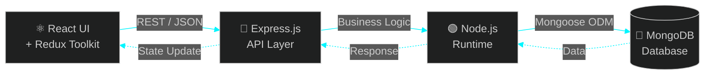

<!-- ═══════════════ HEADER ═══════════════ -->


<div align="center">

<a href="https://yasirshaikh.vercel.app">
  
</a>

<br/>


</div>

<br/>

<!-- ═══════════════ CONNECT ═══════════════ -->
<div align="center">

### ✦ ━━━━━━━━  C O N N E C T  W I T H  M E  ━━━━━━━━ ✦

<a href="https://yasirshaikh.vercel.app" target="_blank">
  
</a>
<a href="https://www.linkedin.com/in/muhammad-yasir-shaikh-73088b302/" target="_blank">
  
</a>
<a href="https://www.instagram.com/yasirshaikh7096/" target="_blank">
  
</a>
<a href="https://x.com/Yasirshaikh1610" target="_blank">
  
</a>

<br/><br/>

<a href="https://yasirshaikh.vercel.app"></a>&nbsp;&nbsp;&nbsp;
<a href="https://www.linkedin.com/in/muhammad-yasir-shaikh-73088b302/"></a>&nbsp;&nbsp;&nbsp;
<a href="https://www.instagram.com/yasirshaikh7096/"></a>&nbsp;&nbsp;&nbsp;
<a href="https://x.com/Yasirshaikh1610"></a>

</div>

<br/>

<!-- ═══════════════ ABOUT ═══════════════ -->
<div align="center">

### ✦ ━━━━━━━━━━━  A B O U T  M E  ━━━━━━━━━━━ ✦

</div>

```js
const yasir = {
  role: "Full Stack MERN Developer",
  stack: ["MongoDB", "Express.js", "React", "Node.js"],
  stateManagement: "Redux Toolkit",
  mindset: ["Curious", "Consistent", "Hungry to grow"],
  learning: "Everyday, one commit at a time",
  motivation: "First in my family in tech — making my parents proud",
  openTo: ["Freelance", "Collaborations", "Learning with great people"],
  funFact: "I love turning ideas into pixels and APIs ⚡",
};
```

<br/>

<!-- ═══════════════ TECH STACK ═══════════════ -->
<div align="center">

### ✦ ━━━━━━━━━  M E R N  A R S E N A L  ━━━━━━━━━ ✦


<sub><b>M</b>ongoDB &nbsp;•&nbsp; <b>E</b>xpress &nbsp;•&nbsp; <b>R</b>eact &nbsp;•&nbsp; <b>N</b>ode.js</sub>

<br/><br/>

**⚛️ Frontend**


**🛠️ Backend & Database**


**🧰 Tools & Workflow**


</div>

<br/>

<!-- ═══════════════ FLOW ═══════════════ -->
<div align="center">

### ✦ ━━━━━━━  H O W  I  S H I P  F U L L  S T A C K  ━━━━━━━ ✦

</div>



<br/>

<!-- ═══════════════ GITHUB STATS ═══════════════ -->
<div align="center">

### ✦ ━━━━━━━━━  G I T H U B  S T A T S  ━━━━━━━━━ ✦


<br/>


</div>

<br/>

<!-- ═══════════════ QUOTE ═══════════════ -->
<div align="center">


</div>

<!-- ═══════════════ FOOTER ═══════════════ -->

